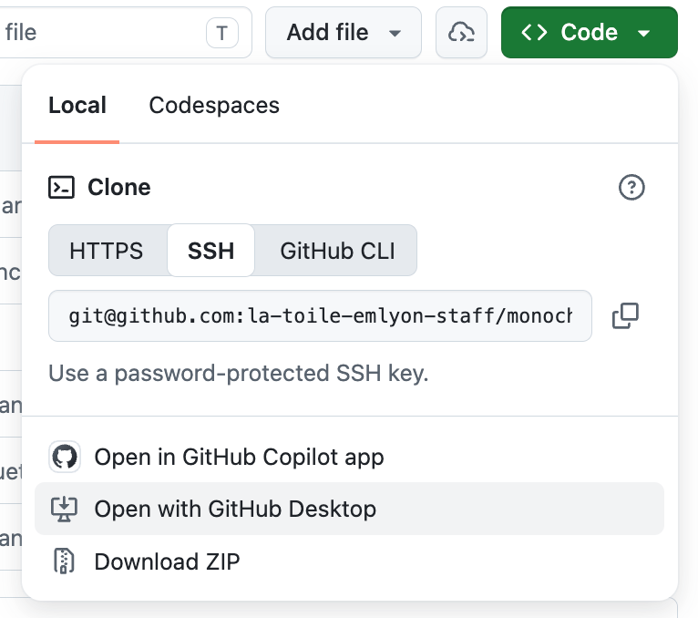
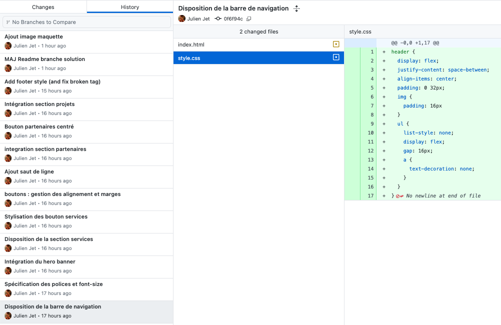

# Intégration maquette Monochrome : Proposition de Solution

Voici une proposition de correction pour la maquette monochrome, qui pourra vous permettre de _suivre la réalisation pas à pas grâce à l'historique de commits_ (de sauvegardes)

Vous pouvez **l'ouvrir avec Github Desktop** de la manière suivante : 

1. cliquer sur le bouton Code
2. cliquer sur Open with Github Desktop

Pour **suivre la correction pas à pas**, vous pouvez _visualiser tour à tour chacune des sauvegardes_ (commit) depuis l'**onglet History**.
Pour chaque commit, vous pouvez voir les modifications apportées à chaque fichier. 

Dans la capture ci-dessous, les fichiers index.html et style.css ont été modifiés.
On voit à l'écran la modification du fichier style.css après avoir cliqué sur le nom du fichier.

